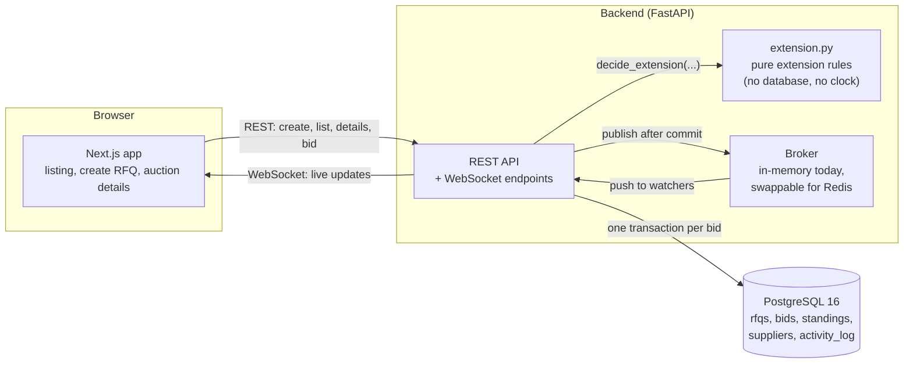
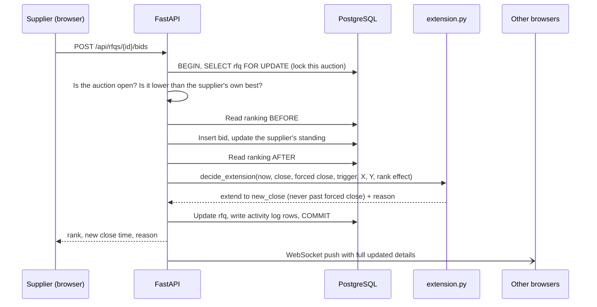
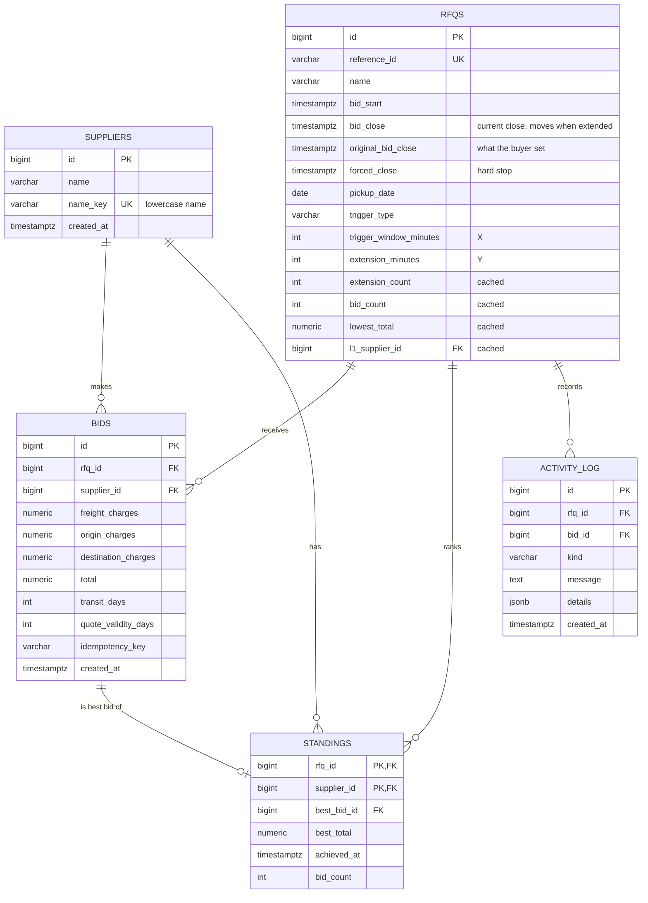

# Architecture and design

## 1. High-level design (HLD)

| Part | Technology | Job |
|---|---|---|
| Frontend | Next.js 16, React, Tailwind | Three pages, live countdown, bid form |
| API | FastAPI, SQLAlchemy 2, Pydantic | Validation, bidding, ranking, extension, live updates |
| Rules | `app/extension.py` | The British auction rules as pure functions |
| Database | PostgreSQL 16 | Source of truth; CHECK constraints protect the rules |
| Live updates | WebSocket + broker | Pushes every new bid to all open pages |
| Packaging | Docker Compose | `docker compose up` starts all three services |

## 2. What happens when a bid arrives

Everything between `BEGIN` and `COMMIT` is one transaction. A bid is saved completely, or not at all.

## 3. The extension rules

For a bid placed at time `now`:

1. **Window:** it only counts if `close - X <= now < close`. The start is inclusive, the close instant is not.
2. **Trigger:** the chosen condition must be true:

| Trigger | Extends when |
|---|---|
| `BID_RECEIVED` | any bid arrives in the window |
| `ANY_RANK_CHANGE` | the ranking order changes in any way (a new supplier entering also counts) |
| `L1_CHANGE` | the lowest bidder changes (the very first bid of an auction counts) |

3. **Cap:** `new_close = min(close + Y, forced_close)`. The close time can never pass the forced close time.

Worked example: close 6:00 PM, forced close 6:08 PM, X = 10 min, Y = 5 min, trigger L1 change.

| Time | Event | Result |
|---|---|---|
| 5:45 | Alpha bids 1500 | Outside the window (opens 5:50). Close stays 6:00. |
| 5:52 | Beta bids 1400 and takes L1 | In the window, L1 changed. Close becomes 6:05. |
| 5:58 | Alpha bids 1450 (still L2) | In the window, but L1 did not change. No extension. |
| 6:03 | Alpha bids 1300 and takes L1 | Window is now 5:55 to 6:05. L1 changed. 6:05 + 5 would be 6:10, so close stops at **6:08** (forced close). |
| 6:07 | Beta bids 1200 and takes L1 | Triggers, but already at the forced close. Logged as `EXTENSION_BLOCKED`. |
| 6:08 | Any bid | Rejected: auction closed (status `FORCE_CLOSED`). |

## 4. Database schema

The full SQL is in [`backend/db/schema.sql`](../backend/db/schema.sql).

### Rules enforced by the database itself

Even a bug in the application cannot save data that breaks these:

| Constraint | Meaning |
|---|---|
| `original_bid_close > bid_start` | close is after start |
| `forced_close > original_bid_close` | forced close is after close |
| `bid_close <= forced_close` | **an extension can never pass the forced close** |
| `bid_close >= original_bid_close` | the close time never moves backwards |
| `trigger_window_minutes > 0 AND extension_minutes > 0` | X and Y are positive |
| `trigger_type IN (...)` | only the three known triggers |
| `UNIQUE (rfq_id, idempotency_key)` | a retried request cannot create two bids |
| bid amounts `>= 0` and `total > 0` | no negative or empty quotes |

### Indexes

| Index | Used for |
|---|---|
| `standings (rfq_id, best_total, achieved_at)` | the ranking board, in order |
| `bids (rfq_id, total, created_at)` | "all bids, lowest first" |
| `activity_log (rfq_id, id)` | the activity timeline |
| `rfqs (bid_close)`, `rfqs (bid_start)` | listing and status filters |

## 5. Design decisions

1. **Status is calculated, never stored.** `SCHEDULED / ACTIVE / CLOSED / FORCE_CLOSED` comes from the current time and the stored times. No background job is needed, and a status can never be out of date. A closed auction is `FORCE_CLOSED` when its close time equals its forced close time.
2. **`bid_close` and `original_bid_close` are separate.** The current close time moves; the original stays. The UI can always show how far an auction was extended.
3. **Bids are append-only.** Bids are never edited or deleted, so the full history is kept.
4. **A `standings` table is the leaderboard.** It holds one row per supplier (their best bid). Ranking cost depends on the number of suppliers, not the number of bids.
5. **Cached columns on `rfqs`** (`lowest_total`, `bid_count`, `extension_count`, `l1_supplier_id`) are updated in the same transaction as each bid, so the listing page never has to aggregate over bids.
6. **Row locking.** `SELECT ... FOR UPDATE` on the auction row means two simultaneous bids on the same auction are handled one after the other, so the rankings and extensions stay correct. Bids on different auctions never block each other.
7. **Pure extension rules.** `extension.py` never reads the clock or database; `now` is passed in. This makes exact moments testable (for example, a bid at exactly the close time).
8. **A server-controlled clock.** The API returns `server_time` and the browser corrects its countdown by the difference, so a wrong computer clock does not change the timer.
9. **Idempotency key.** The bid form sends a key, so a double-click or a retry after a network error cannot create two bids.
10. **Money is exact.** Amounts are `NUMERIC(14,2)` in the database, `Decimal` in Python, and strings in JSON. No floating-point rounding.
11. **Every extension is explained.** The activity log stores the reason, for example "The lowest bidder (L1) changed in the last 10 min before close (shortened to stop at the forced close time)".

### Choices where the assignment was silent

| Question | Decision |
|---|---|
| Is the end of the window inclusive? | No. `close - X <= now < close`. At the close instant, bidding is over. |
| Ties on price? | The earlier bid ranks higher. |
| Does a supplier's first bid count as a rank change? | Yes, because a new rank appears. |
| Does the first bid of an auction count as an L1 change? | Yes (nobody becomes somebody). |
| Can a supplier bid higher than their own previous bid? | No. A new bid must be lower than the supplier's own best. |
| Are "Maersk" and "maersk " the same supplier? | Yes. Names are trimmed and compared ignoring case. |
| What if the trigger happens but the auction is already at its forced close? | Nothing extends, and an `EXTENSION_BLOCKED` entry is logged. |

## 6. Scaling

### Already designed for it
- The API holds no state of its own. Everything is in PostgreSQL, so more API containers can run side by side.
- The row lock is per auction, so many auctions run in parallel.
- Ranking reads `standings`, not every bid.
- The listing reads cached columns, uses indexes, and is paginated.
- The details page caps its payload (200 bids, 100 log entries); full history stays in the database.
- A slow browser connection cannot slow the others: its oldest queued message is dropped.

### Next steps for much larger traffic
- **Redis pub/sub broker.** Live updates currently pass through one process's memory (`app/broker.py`), so the API runs one worker. The broker has just `publish` and `subscribe`, so a Redis version can replace it without touching the routes. Then any number of API containers can share live updates.
- **Read replica** for the listing and details pages.
- **PgBouncer** (connection pooling) in front of PostgreSQL.
- **Partition** `bids` and `activity_log` by auction when they get very large.
- **Rate limiting** per supplier.
